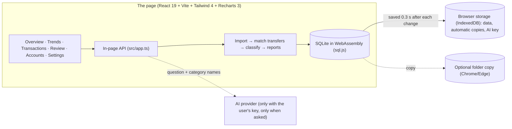
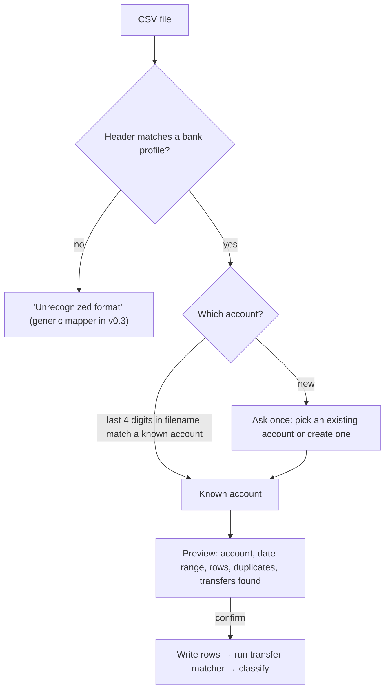
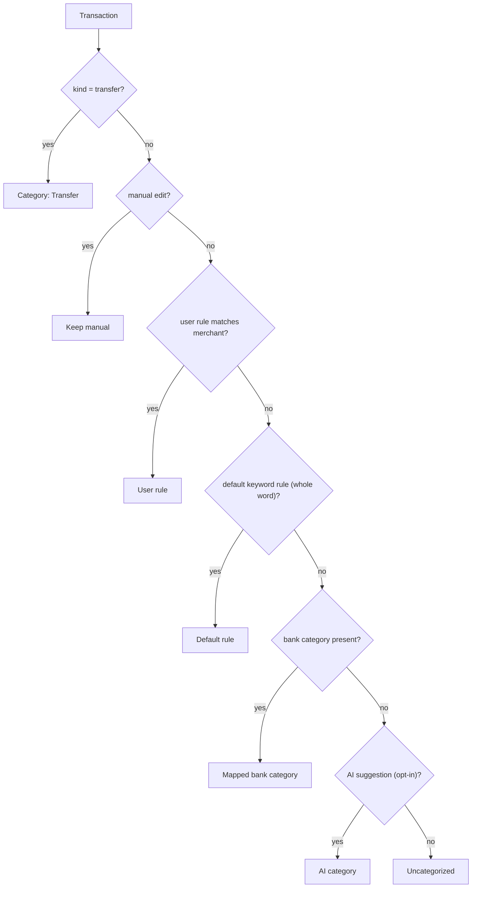
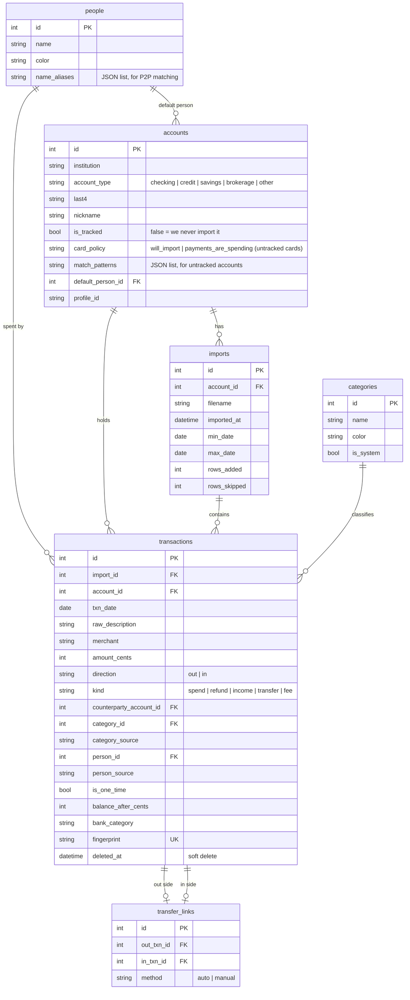
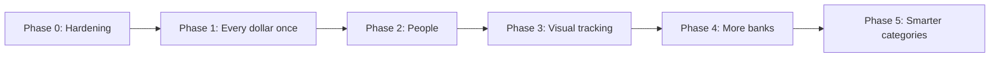

# WalletWhisper — Design Document (v5)

> **Status:** Phases 0–3 implemented · Phase 4 (more banks) waits for real header rows · Phase 5 partly done (AI limited to spending categories) · **Runs:** entirely in the browser; published as a static site at https://walletwhisper.github.io/

### Implementation notes (where the code differs from the plan below)
- **v5: runs in the browser, no server (§3).** The Express server is gone. The same engine runs in the page on SQLite compiled to WebAssembly, and data is saved in the browser (IndexedDB), with automatic copies, backup files and an optional folder copy. This lets the app be hosted for free on GitHub Pages while every user's data stays on their own computer.
- **One-time items (§5.3) → "Show in charts".** Replaced by a per-transaction switch: sort Transactions by amount and untick anything to leave it out of every chart and total (stored in `is_one_time`). No threshold, no review question, no include toggle. Hidden totals are still shown so nothing silently disappears.
- **Ask (new).** Overview and Trends have a question box. With the user's own AI key (Claude, Gemini or OpenAI, recognised from the key), only the question, today's date and category names are sent; the AI returns a period, categories, merchant and person (`src/llm.ts` `planQuestion`), and `src/ask.ts` computes the totals, previous-period and year-ago comparisons, 13-month trend and top merchants locally.
- **Backup files (new).** Settings → Back up or move to another computer exports one `.wwbackup` file (the SQLite database, optionally AES-256-GCM with a scrypt-derived key) and opens it on another computer or browser after checking integrity and schema version; a copy of the replaced data is kept first. `src/backup.ts`. Files from the desktop version, and its `app.db`, still open.
- **Combining backups (new).** Restoring onto a computer that has data first compares them (`src/merge.ts`): rows matched by fingerprint / name / account key / rule pattern; one-sided edits flow automatically; fields changed differently on both sides (decisions, rules, account settings) are conflicts the user resolves, defaulting to the newer `decisions.updated_at`. Local-only transactions are kept unless the user removes them.
- **Where data lives.** In the browser's storage for the site (IndexedDB), with the AI key. In Chrome/Edge the user can also choose a folder that gets a copy after every change (§3).
- **Soft delete → automatic copies.** Undo import, reset, restore, combine and every migration keep a full copy of the database first (plus one a day), instead of soft-delete columns. Simpler, and nothing to filter out of every query.
- **Balance check (§5.5) deferred.** Coverage (§5.4) already catches the realistic failure, missing statements; gaps inside a single export are rare. "Incomplete month" is based on coverage only.
- **Category names:** "Fees" kept (not "Taxes & Fees"). Added Kids, Insurance, Gifts & Donations, Credit card (untracked). Transfer and Income are assigned from `kind`, never by keyword.
- **Review inbox** groups unmatched transfers by payee (`payeeKey`), so one answer covers e.g. all 60+ payments to a card. Patterns can also be set on *imported* accounts, so payments for months whose statement isn't imported are still recognized (and show up as coverage gaps).
- **P2P review** only asks about payments of $500 or more with a recognizable name; smaller P2P payments are spending unless the name is a household member's alias.
- **Re-importing a file** refreshes each existing row's direction (exact from the CSV). It never downgrades a v0.1 row the AI had marked as a transfer; those go to review instead.
- Tests run the engine and the in-page API in Node with in-memory databases (`tests/helpers.ts` `memoryHost`), so they never touch real data.

### What changed from v3
- **New core section (§5): counting every dollar once.** Transfers are matched across accounts, accounts you don't import are listed, payments to cards you don't import follow a policy you choose, there is a coverage map and a monthly check, and uncertain items go to a review inbox.
- **Accounts and people are now core parts of the data.** Each card is identified by its last 4 digits. You mark which person spent each transaction (§7).
- **Visual tracking is the main experience.** There are five screens; Trends shows one-time items separately and marks incomplete months (§8).
- **Security fixes are the first item on the roadmap** (§11, Phase 0).
- **The document now matches the code.** The stack is TypeScript, Express and Vitest; the Python, FastAPI and pytest references are removed. The `ai` category source and the `/api/ai/*` endpoint are documented.

---

## 1. Goal

**User story:** *"We drop CSVs from all our checking and credit card accounts. We see where our money went, who spent it, and on which account, month by month. Money we move between our own accounts is never counted as spending. When the app isn't sure, it asks us once and remembers the answer."*

### Principles
1. **Every dollar is counted once.** Money leaving the household is spending. Money moving between our own accounts counts as zero. A purchase is counted on the account where it was made, never again when the card bill is paid.
2. **Numbers are exact and complete, or the app says they aren't.** Amounts are integer cents. Missing statement periods are shown, not hidden.
3. **We decide; the app suggests.** Who spent what is marked by us. Transfers and categories are suggested automatically and can always be overridden. Every override is remembered.
4. **Visual first.** The charts are how we use the app. The table is how we check the charts.
5. **Local and private by default.** Data stays on this machine. Cloud LLM features are opt-in and show exactly what will be sent.
6. **Adding a bank is cheap.** One profile file, one anonymized fixture, one test.

---

## 2. Scope

### Built (v0.1)
Chase checking and credit profiles · drag-and-drop import · fingerprint dedup · undo import · default, bank and user rules · inline recategorize with "remember" · donut + monthly bar + KPIs + filtered table · Gemini recategorization (`POST /api/ai/recategorize`) · reset.

### Planned (v0.2, this document)
| # | Feature | Done when… |
| :--- | :--- | :--- |
| 1 | Security hardening | A request from another website's page is rejected; destructive actions need confirmation; DB writes are crash-safe |
| 2 | Account identity | Two cards from the same bank are separate accounts, identified by last 4 digits |
| 3 | Transfer matching | A card payment seen in both checking and the card file is linked and excluded from spending on both sides |
| 4 | My accounts (including accounts not imported) | Transfers to savings, brokerage, other banks and household members are not spending, even when the other side is never imported |
| 5 | Untracked card policy | Each card that isn't imported is either "will import" (gap warning) or "count payments as spending"; never counted twice or zero times |
| 6 | One-time items | Large one-off payments (home closing, car, tuition) can be shown separately so they don't swamp trends |
| 7 | Review inbox | Every uncertain item is listed with one-click answers, and answers are remembered |
| 8 | Coverage map + monthly check | Missing months per account are visible; charts mark incomplete months |
| 9 | People | Each transaction can be marked with a person (single row, bulk, per-account default, per-merchant rule) |
| 10 | Visual tracking | Overview + Trends screens with category / person / account breakdowns over time |

### Deferred (v0.3+)
OFX/QFX import · generic column mapper (LLM-assisted) · merchant-level LLM categorization with review queue · budgets · subscription tracking · split transactions · chat · multi-user logins · web hosting.

---

## 3. Architecture

WalletWhisper is a static website: the browser downloads the app once, and everything after that happens inside the page. There is no server, so there is nowhere for anyone's data to go.



- **Same engine, same routes.** The screens still call `/api/...` routes, but `client/src/api.ts` hands them to `LocalApi` (`src/app.ts`) in the page instead of sending them over the network. The engine in `src/` is shared by the page and the tests.
- **SQLite in WebAssembly.** `src/sqlite.ts` wraps sql.js in the small synchronous API the engine already used (`prepare/run/get/all`, `exec`, `pragma`, `transaction` with savepoints), so the engine code didn't change.
- **Saving.** After each change the whole database is exported and written to IndexedDB in one transaction. A failed or interrupted write leaves the previous copy intact, which avoids the corruption risk that ruled out sql.js when it wrote to a file on disk. Data is also saved when the tab is hidden or closed.
- **One tab at a time.** A Web Lock (`navigator.locks`) lets only one tab open the data, so two tabs can't overwrite each other.
- **Automatic copies** (IndexedDB `snapshots`): one a day (7 kept), and one before each undo, reset, restore, combine or schema upgrade (10 kept). Each can be downloaded from Settings.
- **Optional folder copy.** In Chrome and Edge the user can pick a folder (File System Access API). `WalletWhisper data.db` there is rewritten after every change. Browsers ask for permission again after a restart, so a banner offers **Reconnect**. On a new browser, choosing the same folder opens the data in it.
- **Backup reminder.** If there's no folder copy and no backup file in 30 days (starting 3 days after the first import), a dismissible banner suggests downloading one.
- **Content Security Policy.** The built page carries a CSP meta tag (`client/vite.config.ts`): scripts only from the site itself (plus WebAssembly), `connect-src` limited to the site and the three AI APIs, no forms, no plugins. The browser enforces it, so even a bug can't send data elsewhere.

### Stack
| Layer | Choice | Notes |
| :--- | :--- | :--- |
| App | React 19, Vite 8, Tailwind 4, Recharts 3, lucide-react | Built to static files (`client/dist`) with relative paths, so it works at any address |
| Engine | TypeScript in `src/` | Runs in the page; tested in Node |
| Database | SQLite via **sql.js** 1.14 (WebAssembly) | Saved to IndexedDB, not a file |
| CSV parsing | `csv-parse` (browser build) | Handles Chase's trailing comma |
| Hashing / encryption | `@noble/hashes` (SHA-256 fingerprints, scrypt), WebCrypto AES-256-GCM | Same fingerprints and backup format as the desktop version |
| AI | `@anthropic-ai/sdk` (browser mode), `fetch` for Gemini and OpenAI | All three allow browser requests (CORS) |
| Tests | Vitest (engine + in-page API, in Node) | Browser walkthroughs run with Playwright against the built site |
| Hosting | GitHub Pages (`.github/workflows/pages.yml`) | Publishes only after the privacy check and tests pass |

### Running locally
- `npm start` builds the app and opens it at `http://localhost:8000`.
- `npm run dev` starts Vite with hot reload.
- `npm test` runs Vitest.
- Data saved at `localhost:8000` is separate from data saved on the published site, because each address has its own browser storage. Move between them with a backup file.

### Moving from the desktop version
The earlier version kept `app.db` in a data folder. The new version opens that file directly: **I have a backup file** on the welcome screen, or Settings → **Open a backup file**. If the old app left a `-wal` file next to it, first combine them into one file (for example, open it with SQLite and run `VACUUM INTO`), because the browser reads only the main file.

---

## 4. Import Pipeline



- **Account identity.** Chase filenames contain the last 4 digits (`Chase1234_Activity_20261011.CSV`). The app extracts them with a per-profile filename pattern. If there is no match, it asks once and remembers the file's header and last 4 digits for that account.
- **Preview before writing.** The import shows: *"Chase credit ending 1234 · Sep 1 – Oct 11 · 35 new · 12 duplicates · 2 card payments matched to checking"*. Then **[Import] [Cancel]**.
- **Direction is stored on every row** (`direction = 'out' | 'in'`). Today transfers are saved with `abs()`, which loses whether money left or arrived. The matcher needs it.
- **Bank profiles** stay one file each in `src/profiles/`, implementing `BankProfile` from `src/types.ts`:

```ts
export interface BankProfile {
  id: string;                         // "chase_credit"
  bank: string;                       // "Chase"
  accountType: 'credit' | 'checking' | 'savings';
  matches(headers: string[]): boolean;
  last4FromFilename?(filename: string): string | null;
  parseRow(row: Record<string, string>): ParsedRow | null;
}
```

---

## 5. Counting Every Dollar Once (core)

### 5.1 The rule
| Money movement | Counted as | Example |
| :--- | :--- | :--- |
| Purchase on a card or debit card | **Spending**, on the account where it was made | Grocery charge on the credit card |
| Card bill paid from checking | **Transfer** on both sides (zero) | "Payment to Chase card" in checking + "Payment thank you" on the card |
| Between our own accounts | **Transfer** (zero) | Checking → savings, checking → brokerage, Zelle from your own account at another bank |
| Between household members | **Transfer** (zero) | P2P from a partner's personal account |
| To anyone else | **Spending** | Zelle to a contractor, Venmo to a friend, a check for rent |
| Refund from a merchant | **Refund** (reduces that category) | Return on the card, merchant refund deposited into checking |
| Salary, interest, gifts | **Income** | Payroll deposit |

### 5.2 Four layers of protection

**Layer 1: the same row imported twice.**
`fingerprint = sha256(account_id, date, raw_description, amount_cents, occurrence_index)`, where `occurrence_index` counts identical rows within one file. Re-uploading a file or overlapping date ranges adds 0 rows. Two identical coffees on the same day are both kept. *(Built; becomes correct per card once each card has its own account.)*

**Layer 2: the same money in two imported files (transfer matching).**
After every import, the matcher pairs rows that aren't linked yet:

| Condition | Requirement |
| :--- | :--- |
| Accounts | Different accounts, both ours |
| Direction | One `out`, one `in` |
| Amount | Exactly equal in cents |
| Date | The `in` side is −2 to +5 days from the `out` side (card payments post 1–3 days later) |
| Neither row | Already linked, or previously unlinked by the user |

- **Auto-link** when there is exactly one candidate and at least one side looks like a payment or transfer (card `Type = Payment`, or description keywords such as `PAYMENT TO`, `AUTOPAY`, `TRANSFER`, `EPAY`).
- **Send to review** when there are several candidates, or when the amount matches but neither description looks like a transfer.
- A link is stored in `transfer_links`. Both rows become `kind = transfer`, and the table shows *"↔ Chase Checking, Sep 27"*.
- **Unlinking is remembered.** The pair of fingerprints is stored as "not a pair", so the matcher never re-links it.
- **Undoing an import** removes its links. The partner row goes back to "unmatched", and it appears in review if it still looks like a transfer.

**Layer 3: accounts we own but don't import.**
On the Accounts page we list every account we own, including ones we never import (savings, brokerage, retirement, other banks' checking). We also list each person's **name variations** as they appear in P2P descriptions. Each untracked account has **description patterns** (e.g. `TARGET CARD SRVC`, `CITI AUTOPAY`, `FID BKG SVC`).
- A row that matches an untracked own account's pattern becomes `transfer`, linked to that account (`counterparty_account_id`).
- A P2P row (Zelle, Venmo, bank P2P) whose name matches a household member becomes `transfer`. The first match per name goes to review so we can confirm it.
- **Untracked credit cards need a policy**, set once per card:

| Policy | Payments to this card | Use when… |
| :--- | :--- | :--- |
| `will_import` | Excluded as transfer; coverage map shows a gap until the card's CSV is imported | We plan to import this card |
| `payments_are_spending` | Counted as spending in category **"Credit card (untracked)"** | We'll never import it but want its total included |

Without a policy, payments to a card are excluded **and** the card's purchases are never imported, so its spending disappears. With a policy, it's counted exactly once.

**Layer 4: the review inbox.** Anything the rules can't decide is listed with one-click answers (§8.4). Every answer is saved as a decision on that row, and where it makes sense also as a rule (pattern → kind or counterparty), so the same question isn't asked twice.

### 5.3 One-time items
Very large, non-recurring payments (home closing, down payment, car purchase, tuition) are real spending, but they make every other category look tiny.
- A row can be flagged `is_one_time`.
- **Suggested automatically** when a single row exceeds a threshold (default **$5,000**, configurable) or is more than 3× the typical month's total. The suggestion goes to review; it is never applied silently.
- Trends and averages exclude one-time items by default, with a toggle to include them. KPIs show *"One-time: $X"* separately.

### 5.4 Coverage map
For each account, the covered dates are the union of `[min date, max date]` across its imports. Months between the first and last covered month with no coverage are **gaps**.
- The Accounts screen shows one row per account with months filled in and gaps in red.
- In Trends, a month where any tracked account lacks coverage gets a hatched bar and an "incomplete" badge.
- A `will_import` card with payments but no imported rows shows as one long gap.

### 5.5 Monthly check
For each month, the server reports:
- **Unmatched transfers:** transfer-looking rows with no partner and no known counterparty account (count and amount).
- **Balance check (checking accounts):** Chase checking exports include `Balance`. The app stores `balance_after` and verifies that each day's ending balance equals the previous day's ending balance plus that day's net amount. A mismatch means rows are missing or a file was cut short. *(Best effort: within one day, Chase row order is ambiguous, so the check runs on day totals.)*
- **Status:** ✅ complete · ⚠️ needs review · ❌ gap. Shown on the Overview and next to each month in Trends.

---

## 6. Categorization



- **`category_source`:** `manual` > `user_rule` > `default_rule` > `bank` > `ai` > `uncategorized`. Rules and AI never overwrite `manual` or `user_rule`.
- **AI may change only the category, never `kind`.** Today `llm.ts` can also update `kind`, which could turn spending into a transfer without anyone seeing it. That is now the matcher's and the review inbox's job.
- **Merchant cleaner:** strips `SQ *`, `TST*`, `PAYPAL *`, `POS `, `DEBIT CARD PURCHASE`, store numbers, long digit runs, ACH `PPD ID:` / `WEB ID:` suffixes, and trailing `CITY ST`; then title-cases. Its main job is a **stable key for rules**.
- **Default categories:** Groceries, Dining, Transport, Gas, Shopping, Subscriptions, Utilities, Housing, Health, Travel, Entertainment, Kids, Insurance, Taxes & Fees, Gifts & Donations, Credit card (untracked), Transfer, Income, Uncategorized.
- **Chase category map:** `Food & Drink → Dining`, `Groceries → Groceries`, `Gas → Gas`, `Shopping → Shopping`, `Travel → Travel`, `Bills & Utilities → Utilities`, `Health & Wellness → Health`, `Entertainment → Entertainment`, `Fees & Adjustments → Taxes & Fees`, …

---

## 7. People

The app **never guesses** who spent what. It only makes marking fast.

- **People list:** e.g. "Alex", "Sam", "Shared", "Kids". Each has a color and optional **name variations** (used only to recognize P2P transfers between household members, §5.2).
- **Per-account default person (optional, chosen by us):** "This card is Alex's." New rows from that account start with that person. Rows we change stay changed.
- **Per-transaction dropdown** in the table.
- **Bulk marking:** select rows with checkboxes or shift-click, then **[Assign to ▾]**.
- **Optional "always for this merchant"** checkbox, which creates a person rule, like category rules.
- **`person_source`:** `manual` > `person_rule` > `account_default` > none. Re-imports and rules never overwrite `manual`.
- Every chart can be **filtered** by person and **stacked** by person.

---

## 8. Visual Tracking

### 8.1 Screens
| Screen | Purpose |
| :--- | :--- |
| **Overview** | This month at a glance: spent vs. typical month, donut by category, biggest changes, monthly check status |
| **Trends** | Monthly stacked bars over 6 / 12 / 24 months, stacked by **category, person or account**; one-time items shown separately; incomplete months marked |
| **Transactions** | The source of truth: filters, search, bulk marking, transfer links, count and sum of visible rows |
| **Review** | The inbox: unmatched transfers, possible self-transfers, one-time suggestions, new P2P names |
| **Accounts** | My accounts (imported and untracked), card policies, coverage map, import history with undo |

### 8.2 Overview
```
┌──────────────────────────────────────────────────────────────────────────┐
│ WalletWhisper       [Overview] Trends  Transactions  Review(3)  Accounts │
│                                        [Oct 2026 ▾]  [⬆ Import CSVs]     │
├────────────────┬────────────────┬────────────────┬───────────────────────┤
│ Spent $4,210   │ vs typical     │ One-time $0    │ ✅ Month complete      │
│ 163 txns       │ ▲ 8% ($3,890)  │                │ 0 items to review     │
├────────────────┴────────┬───────┴────────────────┴───────────────────────┤
│  Donut by category      │  Biggest changes vs typical month              │
│  hover → amount · %     │  Dining      ▲ $212  (14 txns)                 │
│  click → Transactions   │  Utilities   ▼ $ 85                            │
│                         │  Kids        ▲ $140                            │
├─────────────────────────┴────────────────────────────────────────────────┤
│  By person:  Alex $1,920 ████████   Sam $1,410 ██████   Shared $880 ███  │
└──────────────────────────────────────────────────────────────────────────┘
```
"Typical month" = median of the last 6 **complete** months, excluding one-time items.

### 8.3 Trends
```
┌──────────────────────────────────────────────────────────────────────────┐
│ Stack by: (•) Category ( ) Person ( ) Account   Range: [12 months ▾]     │
│ [ ] Include one-time items          Filters: [Sam ✕] [Chase Credit ✕]    │
│                                                                          │
│  $6k ┤          ▓▓                                                       │
│  $4k ┤ ▓▓  ▓▓   ▓▓  ▓▓  ░░  ▓▓  ▓▓  ▓▓                                   │
│  $2k ┤ ▓▓  ▓▓   ▓▓  ▓▓  ░░  ▓▓  ▓▓  ▓▓      ░░ = incomplete month        │
│      └─Mar─Apr──May─Jun─Jul─Aug─Sep─Oct                                 │
│  click a bar segment → Transactions filtered to that month + segment     │
└──────────────────────────────────────────────────────────────────────────┘
```

### 8.4 Review inbox
```
┌──────────────────────────────────────────────────────────────────────────┐
│ Review (3)                                                               │
├──────────────────────────────────────────────────────────────────────────┤
│ Sep 25  Chase Credit  "Payment thank you"  $1,250.00                     │
│ No matching payment found in imported accounts.                          │
│ [Paid from an untracked account ▾]  [It's spending]  [Ignore]            │
├──────────────────────────────────────────────────────────────────────────┤
│ Aug 12  Chase Checking  "Zelle payment from A. Example"  $2,000.00       │
│ Looks like a household member. Is "A. Example" one of us?                │
│ [Yes → Alex]  [No, it's income]                                          │
├──────────────────────────────────────────────────────────────────────────┤
│ Jul 30  Chase Checking  "Domestic wire … closing cost"  $48,000.00       │
│ Much larger than a typical month.                                        │
│ [One-time]  [Normal spending]  [Transfer to my account ▾]                │
└──────────────────────────────────────────────────────────────────────────┘
```

### 8.5 Interaction rules
| Action | Result |
| :--- | :--- |
| Hover a slice or bar segment | Tooltip: name, amount, % of the filtered total, transaction count |
| Click a slice or segment | Opens Transactions filtered to it; the filter shows as a chip |
| Click a chip's `✕` | Clears that filter |
| Change the date range | Updates every view together |
| Filter state | Lives in the URL (`?from=…&to=…&cat=…&person=…&acct=…`) so it can be bookmarked and survives a refresh |
| Drop files anywhere | Opens the import preview (§4) |
| Empty state | Large dropzone: "Drop your bank CSV exports here" |

---

## 9. Data Model



Supporting tables:
- **`rules`** (`match_type`, `pattern`, `target`: category / person / kind / counterparty, `priority`, `source`)
- **`decisions`** (fingerprint → user answer). Answers from review and manual edits are keyed by fingerprint, so they **survive undoing and re-importing a file**. Today a manual category edit is lost if its import is deleted.
- **`not_pairs`** (fingerprint pairs the user unlinked)
- **`audit_log`** (destructive actions)

**Migrations.** Use `PRAGMA user_version` plus numbered migration files in `src/migrations/`. Before migrating, the app copies `app.db` to a timestamped backup. The existing v0.1 database is migrated in place:
- Accounts get `last4 = NULL` and are asked about on the next import.
- `direction` is backfilled from `kind` (and from `Balance` changes where available).
- The transfer matcher runs once over all existing rows, and the results go to review.

**Indexes:** `transactions(txn_date)`, `transactions(account_id, txn_date)`, `transactions(person_id)`.

---

## 10. API

The routes run inside the page (`src/app.ts`), not over the network. Paths and request shapes are kept from the server version so the screens didn't change.

| Method | Path | Purpose |
| :--- | :--- | :--- |
| `GET` / `POST` | `/api/setup` | Is there data in this browser? / start fresh |
| `POST` | `/api/imports/preview` | CSV files → per file: detected profile, account (or "ask"), date range, new / duplicate counts. Nothing is written |
| `POST` | `/api/imports` | Import the previewed files (with the chosen account per file) |
| `GET` / `DELETE` | `/api/imports`, `/api/imports/:id` | Import history / undo an import (a copy is kept first) |
| `GET` | `/api/summary`, `/api/trends`, `/api/coverage` | Overview, Trends and coverage, with filters |
| `GET` | `/api/transactions`, `/api/transactions/values` | Filtered, sorted list with totals / values for a column filter |
| `PATCH` | `/api/transactions/:id`, `/api/transactions` | Edit one / many: category, person, kind, show in charts, remember |
| `POST` / `DELETE` | `/api/transfer-links` | Link or unlink two rows manually |
| `GET` / `POST` | `/api/review`, `/api/review/answer` | Review inbox |
| `GET` / `POST` / `PATCH` / `DELETE` | `/api/accounts`, `/api/people`, `/api/rules`, `/api/person-rules` | Accounts, people, remembered rules |
| `GET` / `PUT` | `/api/settings`, `/api/settings/ai` | Whether AI is on (never the key) / save or remove the key |
| `POST` | `/api/ask`, `/api/ai/recategorize` | Opt-in AI (§12) |
| `POST` | `/api/backup/export`, `/inspect`, `/compare`, `/merge`, `/restore` | Backup files and combining |
| `POST` | `/api/reset` | Requires typing `DELETE ALL` |

---

## 11. Security & Privacy

**Threat model:** the hosting site, other websites open in the same browser, a shared or lost computer, mistakes (accidental deletion), and data sent to an AI provider.

| Risk | Fix |
| :--- | :--- |
| **The website could collect data.** | There is no server. GitHub Pages serves only the built files. Statements are read with the browser's file APIs and never sent. The CSP's `connect-src` allows only the site itself and the three AI APIs, so the page can't send data anywhere else even by mistake |
| Other websites reading the data | Browser storage is private to each origin (scheme + host + port; the path does not count). All GitHub Pages sites of one account share `<account>.github.io`, so WalletWhisper is published from its own organization, at `walletwhisper.github.io`, where no other site can read its storage |
| Two tabs overwriting each other | Web Lock: the second tab shows "already open in another tab" |
| Browser storage cleared or evicted | `navigator.storage.persist()` is requested; automatic copies; backup-file reminder; optional folder copy |
| Destructive actions | Typed confirmation (`DELETE ALL` to reset, `ERASE` to erase the browser's data); a copy is kept before undo, reset, restore and combine; `audit_log` entry |
| Lost laptop / shared PC | Turn on BitLocker / FileVault. Use a separate browser profile per person. Backup files can be password-protected (AES-256-GCM, scrypt) |
| Malicious or huge CSV | 10 MB / 20 files per import / 50k rows per file; strict parsing |
| AI data exposure | §12. The key is stored only in this browser and sent only to its provider |
| Personal data in the repo | `data/`, `*.db`, `*.csv`, `*.wwbackup`, `.env` are git-ignored; the privacy check runs on commit, push, in CI and before every Pages publish; fixtures and docs use made-up data |
| Dependencies | Committed lockfiles, exact versions for the core packages, no server dependencies left |

---

## 12. LLM Features (opt-in)

The app works fully without an LLM. When the user pastes their own key in Settings (Claude, Gemini or OpenAI, recognised from the key; stored only in their browser and sent only to that provider):

| Feature | Sends | Guardrails |
| :--- | :--- | :--- |
| **Merchant categorization** (built, to be improved) | Cleaned merchant names only, **once per merchant** (cached), with the category list | Answer must be a category ID from the list; low confidence → review; never changes `kind`; never overwrites `manual` / `user_rule` |
| **Column mapping for unknown CSVs** (v0.3) | Header row + 3 sample rows with amounts and names masked | User confirms the mapping; saved as a profile |
| **Monthly summary text** (later) | Aggregates already computed by SQL | The LLM writes sentences only; every number comes from SQL |
| **Chat** (later) | Question + category / person / account names | The LLM returns a **structured filter** (validated JSON), never SQL; the app runs parameterized queries in the page |

**Privacy rules:**
- A "what will be sent" preview appears before the first call of each feature.
- No account numbers, balances, dates or people's names are sent for categorization.
- Use a **paid API tier**: free tiers may use submitted data for training.
- **Accuracy is measured, not assumed:** the review screen shows how often the AI's category matched our manual choice.

---

## 13. Roadmap



| Phase | Delivers | Exit criteria |
| :--- | :--- | :--- |
| **0. Hardening** | Remove `cors()`, Host/Origin check, write token, reset confirmation, better-sqlite3 + WAL, migrations framework, backups, AI never changes `kind` | Security tests S-01–S-03 pass; existing DB migrates with a backup; all current tests green |
| **1. Every dollar once** | Account identity (last 4), import preview, `direction`, transfer matcher, untracked accounts + patterns, card policies, household P2P, one-time items, review inbox, coverage map, monthly check, decisions survive re-import | On our real data: every card payment is linked or explained; review inbox reaches 0; spending total matches a hand check for 2 months |
| **2. People** | People list, per-row and bulk marking, account defaults, person rules, person filter | Can mark a month's transactions in < 2 minutes; charts split by person |
| **3. Visual tracking** | Overview + Trends screens, stack by category / person / account, typical-month comparison, incomplete-month marking | Answers "what changed this month and who spent it" without opening the table |
| **4. More banks** | BoA, Santander, TD profiles; OFX/QFX parser; generic column mapper | Each new bank: fixture test passes with no core code change |
| **5. Smarter categories & extras** | Merchant-level LLM with cache + review + accuracy; budgets; subscription detection | Uncategorized < 5% of spending; AI agreement shown |

---

## 14. Test Plan

### 14.1 Fixtures
`tests/fixtures/` holds **anonymized** CSVs with the real headers and quirks. Phase 1 adds a **matched set**: a checking file and a credit file covering the same month, containing:
- a card payment that appears in both files;
- a payment to a card that isn't imported;
- a transfer to savings;
- a Zelle from a household member and a Zelle to a third party;
- a merchant refund into checking;
- a very large one-off payment;
- two identical same-day purchases.

Each fixture set has an `*.expected.json` file with the exact spending total, per-row `kind`, and the expected links.

### 14.2 Backend (Vitest)
| ID | Test | Assert |
| :--- | :--- | :--- |
| P-01 / P-02 | Profile detection | Each Chase header matches only its own profile; trailing comma handled |
| P-03 | Unknown header | "Unrecognized format"; nothing written |
| P-04 | Last 4 from filename | `Chase1234_Activity_….CSV` → account ending 1234; two cards → two accounts |
| N-01 | Sign + direction | Purchases positive spend `out`; returns negative refund; payments `in` on the card |
| N-02 | Cents precision | `$0.10 + $0.20` = exactly 30 cents |
| D-01 / D-02 / D-03 | Dedup | Same file → 0 added; identical same-day rows both kept; overlapping files add only new rows |
| X-01 | Card payment in both files | Linked; neither side in spending; **total = card purchases + checking purchases only** |
| X-02 | Import order doesn't matter | Card file first then checking, or the reverse → same links, same total |
| X-03 | Ambiguous match | Two equal payments in the window → review item, no auto-link |
| X-04 | Unlink remembered | After unlinking and re-running the matcher, the pair stays unlinked |
| X-05 | Undo import | Removing the checking import unlinks the card side → card payment appears in review |
| X-06 | Untracked card `will_import` | Payment excluded; coverage shows a gap |
| X-07 | Untracked card `payments_are_spending` | Payment counted once in "Credit card (untracked)" |
| X-08 | Transfer to own savings (untracked) | Matches the pattern → transfer, not spending |
| X-09 | Household P2P vs. third-party P2P | Member → transfer; third party → spending |
| X-10 | One-time | Flagged row excluded from trends and typical month; still in the "One-time" KPI |
| X-11 | Invariant | `spending total = Σ out-flows to non-own parties − refunds`, for any range |
| X-12 | Coverage | Gap months detected; incomplete months flagged in `/api/trends` |
| X-13 | Balance check | Removing a row from a checking fixture → monthly check reports a mismatch |
| C-01 | Merchant cleaner | `"SQ *BLUE BOTTLE #12 OAKLAND CA"` → `"Blue Bottle"` |
| C-02 / C-03 | Rule precedence; manual protection | user > default > bank > ai > uncategorized; rules never change `manual` |
| C-04 | AI can't change kind | An AI response that implies a transfer does not change `kind` |
| C-05 | Decisions survive re-import | Manual category + person kept after undo + re-import |
| H-01 | Bulk person marking | 50 rows assigned in one request; `person_source = manual` |
| A-01 | Summary invariant | `Σ by_category = Σ by_person = Σ by_account = Σ by_month = total_spend` |
| S-01 | Foreign origin | Write request with `Origin: https://evil.example` → 403 |
| S-02 | Wrong host | Request with `Host: attacker.example` → 403 |
| S-03 | Reset needs token | `POST /api/reset` without a confirmation token → 400; nothing deleted |

### 14.3 Frontend and end-to-end
- Slice / segment click filters Transactions; chips clear filters; footer sum equals the clicked amount.
- Review answer removes the item and updates totals.
- Bulk person assignment updates the person chart.
- E2E (Playwright, Phase 3): empty state → import matched fixture set → preview shows 1 match → Overview total equals the expected total → review inbox empty after answering → Trends stacked by person.

### 14.4 Manual acceptance (with our real data)
- [ ] Every card payment in checking is linked, or explained by an untracked-account answer.
- [ ] No transfer between our own accounts appears as income or spending.
- [ ] Coverage map shows the real gaps; we import or explicitly accept them.
- [ ] Spending for two chosen months matches a hand check to the cent.
- [ ] One-time items are flagged and trends look sensible without them.

---

## 15. Open Decisions

| Question | Default until decided |
| :--- | :--- |
| One-time threshold | $5,000 or > 3× typical month; suggestion only |
| Do we need separate logins or private views per person? | No: one shared local view |
| Will we use the app from a phone or another computer? | Another computer: yes, through backup files (combined if both have changes) or a folder copy. It is hosted as a static site with no server, so no sign-in is needed: each browser holds its own data. Phones: the site loads, but the screens are designed for a computer |
| Splitting one transaction between people ("who owes whom") | Deferred; each row has one person (use "Shared" for joint spending) |

---

## Appendix A: Bank Profiles

| Status | Bank | Notes |
| :--- | :--- | :--- |
| ✅ Built | **Chase credit** | `Transaction Date,Post Date,Description,Category,Type,Amount,Memo`. Purchases negative → `amount_cents = −Amount`. `Type`: Sale → spend, Return → refund, Payment → transfer (`in`), Fee/Adjustment → fee. `Category` used as bank-category fallback |
| ✅ Built | **Chase checking** | `Details,Posting Date,Description,Amount,Type,Balance,Check or Slip #`. Debits negative. **Data rows have a trailing comma** (one extra field), so parse by header position. `Balance` used for the balance check |
| Committed | **Bank of America** | Checking export has a summary block above the header, so scan for the header line. Card: `Posted Date,Reference Number,Payee,Address,Amount` |
| Committed | **Santander** | Need a sample header |
| Committed | **TD Bank** | Need a sample header; likely separate Debit / Credit columns |
| Likely | **Capital One / Citi / Discover** | Separate Debit / Credit columns (Capital One, Citi); Citi `Status` column (skip pending); Discover charges positive |

Every profile is written against a **real header row** from our own export, never guessed. To add a bank, share its first line only (no data rows).
