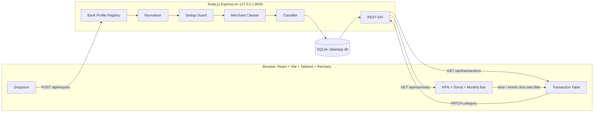
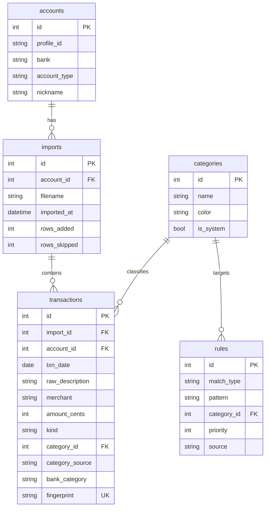
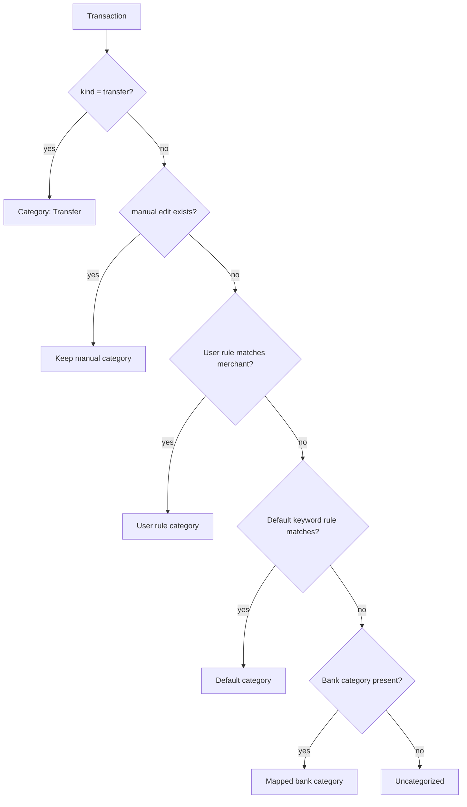
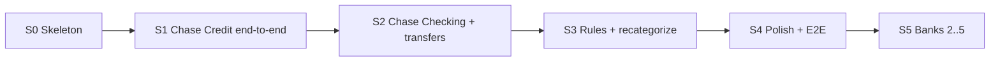
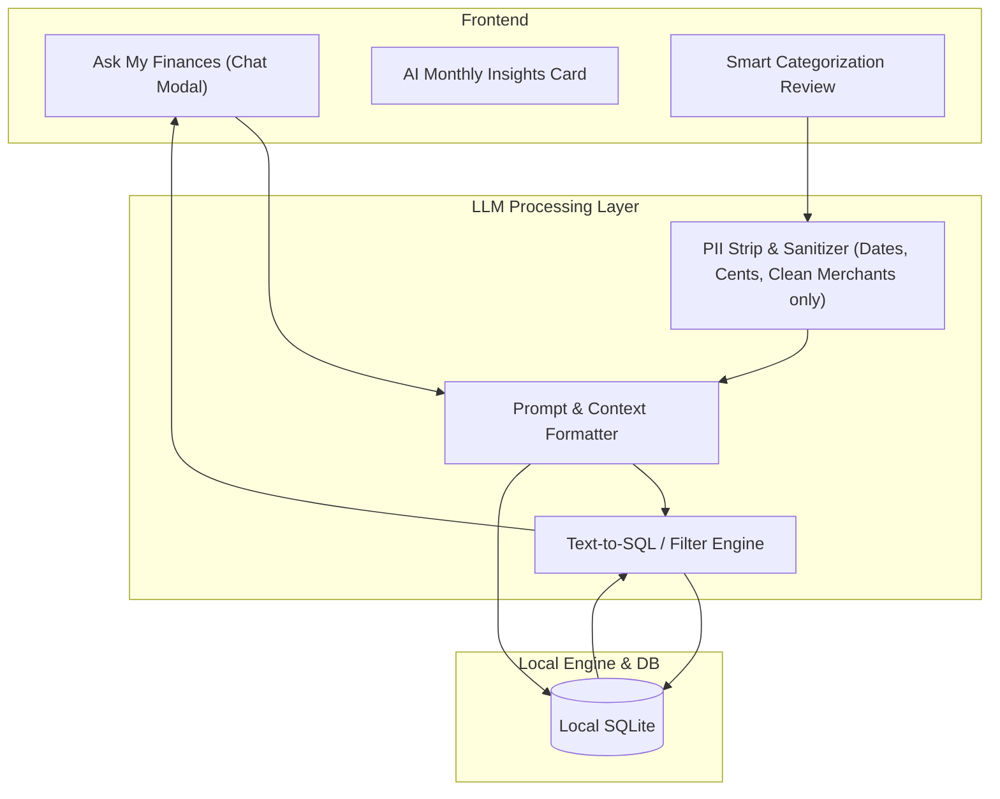

# Spending Analyzer — Design Document (v3)

> **Status:** Draft for approval · **First bank:** Chase (checking + credit card) · **Next:** BoA, Santander, TD Bank · **Likely:** Capital One, Citi, Discover · **Runs:** localhost only (web later)

---

## 1. Goal

**User story:** *"I drop CSVs from my checking and credit card accounts, and within seconds I see where my money went. I hover a slice to see what it is, click it to see the exact transactions, and if I fix a category once, it stays fixed."*

### Principles
1. **Correct numbers first.** No double-counting card payments, refunds reduce spending, exact cents.
2. **Zero-friction import.** Drop files → dashboard. No mapping step for supported banks.
3. **Adding a bank is cheap.** One profile file + one sample CSV + one test.
4. **Local and private.** Data never leaves the machine. The architecture can still move to the web later.

---

## 2. MVP Scope

### v0.1 — Must have
| # | Feature | Done when… |
| :--- | :--- | :--- |
| 1 | Drag-and-drop multiple CSVs | Chase checking + Chase credit CSVs import with no manual steps |
| 2 | Account-aware normalization | Spending is positive, amounts stored in integer cents, dates in ISO format |
| 3 | Transfer / card-payment exclusion | Paying the card from checking is **not** counted as spending |
| 4 | Refund handling | Returns reduce their category's total instead of counting as income |
| 5 | Dedup + undo import | Re-uploading the same file adds 0 rows; any import can be deleted |
| 6 | Categorization | User rules → default keyword rules → bank's own category → `Uncategorized` |
| 7 | Dashboard | KPI cards + **donut** (hover = amount & %, click = filter) + **monthly bar** (click = filter month) |
| 8 | Date filter | This month / Last month / Last 3 months / YTD / All. It drives every view |
| 9 | Transaction table | Filtered by slice + month + date + search; shows count and sum of visible rows |
| 10 | Recategorize + "remember" | Inline category change, with optional "always for this merchant". Manual edits are never overwritten |

### Deferred (v0.2+)
Generic column mapper for unknown banks · budgets & alerts · Sankey · LLM categorization · split transactions · multi-currency · Plaid sync · auth / multi-user · export.

---

## 3. Architecture



### Stack
| Layer | Choice | Why |
| :--- | :--- | :--- |
| Backend | Node.js (Express), TypeScript, SQLite (sql.js / better-sqlite3) | Zero setup, fast, embedded database, binds to 127.0.0.1 |
| CSV parsing | csv-parse/sync | Reliable CSV parser, handles Chase trailing commas and disparate columns |
| Frontend | React + TypeScript + Vite + Tailwind | Fast dev loop; static build served by Express in single process |
| Charts | Recharts | Interactive Donut and Monthly Bar with hover tooltips and click filters |
| Tests | Vitest + Supertest | Unit tests for parser/normalizer and integration tests for API invariants |

### Storage & Privacy Rationale (Why SQLite vs. MySQL)
- **Zero-Setup & Serverless**: Unlike MySQL, SQLite requires no background database daemon, root passwords, or port setup. It runs embedded inside the app.
- **Single-File Portability**: All your historical transactions, categories, and custom rules are saved in one local file (`data/app.db`). Backing up your finances is as simple as copying this file to a USB drive.
- **Air-Gapped Privacy**: Raw CSV statements are processed in memory and never permanently stored on disk. The server binds strictly to `127.0.0.1:8000` (localhost only). `.gitignore` protects `data/app.db` and all `*.csv` files from being committed to GitHub.
- **Future Cloud Path**: Uses standard SQL schemas (`accounts`, `imports`, `transactions`, `categories`, `rules`). If moved to the cloud later, it migrates seamlessly to PostgreSQL or MySQL.

### Running locally
- **Daily use:** `npm start` runs `node run.js`, starts the server on `http://127.0.0.1:8000`, and automatically opens your browser. **One process, one command.**
- **Testing:** `npm test` runs Vitest test suite.
- **Development:** `npm run dev:server` (API) and `npm run dev:client` (Vite frontend with hot reload).

---

## 4. Bank Profile Registry (scales to 4–5 banks)

Each bank/account type is one small profile. The importer tries every registered profile's `matches()` against the header row and uses the first exact match. If nothing matches, the import fails with *"Unrecognized format"* (the generic mapper comes in v0.2).

```python
class BankProfile(Protocol):
    id: str                 # "chase_credit"
    bank: str               # "Chase"
    account_type: str       # "credit" | "checking"
    def matches(self, header: list[str]) -> bool: ...
    def parse_row(self, row: dict) -> ParsedRow: ...
    # ParsedRow: date, raw_description, amount_cents (signed: + = money out),
    #            kind ("spend" | "refund" | "income" | "transfer" | "fee"),
    #            bank_category (optional)
```

**Adding a bank** = `profiles/<bank>_<type>.py` + `tests/fixtures/<bank>_<type>.csv` + expected JSON. No other code changes.

### 4.1 Chase profiles (v0.1)

**Chase credit card**
```
Transaction Date,Post Date,Description,Category,Type,Amount,Memo
```
| Field | Rule |
| :--- | :--- |
| Date | `Transaction Date` (`MM/DD/YYYY`) |
| Amount sign | Purchases are **negative**, so `amount_cents = -Amount` |
| `Type = Sale` | `spend` |
| `Type = Return` | `refund` (nets against its category) |
| `Type = Payment` | `transfer` (excluded) |
| `Type = Fee / Adjustment` | `fee` / `spend` |
| `Category` | used as the `bank_category` fallback |

**Chase checking**
```
Details,Posting Date,Description,Amount,Type,Balance,Check or Slip #
```
| Field | Rule |
| :--- | :--- |
| Date | `Posting Date` |
| Amount sign | Debits are **negative**, so `amount_cents = -Amount` |
| `Type` in `ACCT_XFER`, `LOAN_PMT`, or description matches card-payment patterns | `transfer` |
| `Details = CREDIT` and not a transfer | `income` |
| Everything else | `spend` |

> [!WARNING]
> Chase checking CSVs have a **trailing comma** on data rows (one more field than the header). Parse by position from the header and ignore extra empty fields. Otherwise every column shifts by one.

### 4.2 Bank roadmap

| Priority | Bank | Known / expected quirks (to confirm with a real header row) |
| :--- | :--- | :--- |
| ✅ v0.1 | **Chase credit** | Header confirmed: `Transaction Date,Post Date,Description,Category,Type,Amount,Memo` |
| ✅ v0.1 | **Chase checking** | Header confirmed: `Details,Posting Date,Description,Amount,Type,Balance,Check or Slip #` |
| Committed | **Bank of America** | Checking export has a summary block **above** the real header row, so scan for the header line. Card export uses `Posted Date,Reference Number,Payee,Address,Amount` |
| Committed | **Santander** | Format not yet known. Need a sample header |
| Committed | **TD Bank** | Format not yet known; likely separate `Debit` / `Credit` columns. Need a sample header |
| Likely | **Capital One** | Separate `Debit` / `Credit` columns; has its own `Category` column |
| Likely | **Citi** | Separate `Debit` / `Credit` columns; `Status` column (skip pending rows) |
| Likely | **Discover** | `Trans. Date`, `Post Date`; charges positive, payments negative; has its own `Category` column |

> [!NOTE]
> Every profile is written against a **real header row** from your own export, never guessed. When you're ready to add a bank, send its first line (no data rows).

---

## 5. Correctness Rules

| Rule | Implementation |
| :--- | :--- |
| **Money** | Stored as integer cents. Formatted only in the UI |
| **Spending total** | `SUM(amount_cents) WHERE kind IN ('spend','refund','fee')`. Refunds are negative, so they net out |
| **Transfers** | `kind = 'transfer'` is excluded from all spending views. Seed patterns: `AUTOPAY`, `PAYMENT THANK YOU`, `CHASE CREDIT CRD`, `ONLINE TRANSFER`, `EPAY`. Users can also mark any transaction as Transfer |
| **Income** | Shown only as a KPI ("Money in"). Never in the spending donut |
| **Dedup** | `fingerprint = sha256(account_id, date, raw_description, amount_cents, occurrence_index)`, where `occurrence_index` is the Nth identical row in the file. Re-uploading the same file adds 0 rows; two identical coffees on the same day are both kept |
| **Overlapping statements** | Same fingerprint scheme, so overlapping date ranges across files are safe |
| **Manual edits win** | `category_source ∈ {bank, default_rule, user_rule, manual}`. Rules never overwrite `manual` |

---

## 6. Data Model (SQLite)



- **Account resolution:** v0.1 creates one account per `profile_id` automatically. Nicknames and multiple cards per bank come in v0.2.
- **Undo import:** `DELETE FROM transactions WHERE import_id = ?` and then the import row.

---

## 7. Categorization



- **Merchant cleaner (kept small):** strip prefixes `SQ *`, `TST*`, `SP `, `PAYPAL *`, `POS `, `DEBIT CARD PURCHASE`. Strip store numbers like `#\d+` and long digit runs, and trailing `CITY ST`. Then title-case. Its main job is a **stable key for rules**.
- **Default categories:** Groceries, Dining, Transport, Gas, Shopping, Subscriptions, Utilities, Housing, Health, Travel, Entertainment, Fees, Transfer, Income, Uncategorized.
- **Chase category map:** `Food & Drink → Dining`, `Groceries → Groceries`, `Gas → Gas`, `Shopping → Shopping`, `Travel → Travel`, `Bills & Utilities → Utilities`, `Health & Wellness → Health`, `Entertainment → Entertainment`, `Fees & Adjustments → Fees`, and so on.
- **"Remember" behavior:** creates a `user_rule` (`merchant equals X → category`). It applies retroactively to all non-manual transactions with that merchant, and to future imports.

---

## 8. API

| Method | Path | Purpose |
| :--- | :--- | :--- |
| `POST` | `/api/imports` | Multipart, one or more CSVs. Returns a result per file: `{filename, profile_id, added, skipped, error?}` |
| `GET` | `/api/imports` | List past imports |
| `DELETE` | `/api/imports/{id}` | Undo an import |
| `GET` | `/api/summary?from&to` | `{total_spend, money_in, txn_count, by_category:[{id,name,color,cents,pct}], by_month:[{month,cents}]}` |
| `GET` | `/api/transactions?from&to&category_id&month&q&sort` | Filtered list + `{count, sum_cents}` |
| `PATCH` | `/api/transactions/{id}` | `{category_id, remember: bool}` |
| `GET` | `/api/categories` | Names and colors for chart and dropdown |

---

## 9. UI

```
┌──────────────────────────────────────────────────────────────────────┐
│ Spending Analyzer        [This month ▾]          [⬆ Import CSVs]    │
├──────────────┬──────────────┬──────────────┬─────────────────────────┤
│ Spent $2,431 │ Money in $5k │ Top: Dining  │ 142 transactions        │
├──────────────┴──────────────┴──┬───────────┴─────────────────────────┤
│        Donut by category       │   Monthly spending (bar)            │
│   hover → "Dining $412 · 17%"  │   click bar → filter to that month  │
│   click → filter table         │                                     │
├────────────────────────────────┴─────────────────────────────────────┤
│ Filters: [Dining ✕] [Sep 2026 ✕]  🔍 search…    24 txns · $412.18    │
│ Date       Merchant        Account       Amount    Category ▾        │
│ 09/28      Sweetgreen      Chase Credit  $14.50    [Dining ▾]        │
│ ...                                                                  │
└──────────────────────────────────────────────────────────────────────┘
```

### Interaction rules
| Action | Result |
| :--- | :--- |
| Hover slice / bar | Tooltip shows name, amount, and % of the filtered total. The slice expands slightly |
| Click slice | Sets `category` filter; slice highlighted; others dimmed; table filters |
| Click the same slice again or the `✕` chip | Clears the category filter |
| Click month bar | Sets `month` filter (donut also re-computes for that month) |
| Date dropdown | Changes the range for KPIs, donut, bars, and table together |
| Change category in table | Dropdown + "Always for *Sweetgreen*" checkbox; chart refreshes |
| Drop files anywhere | Upload overlay; a toast per file: "Chase Credit: 87 added, 12 skipped" or an error |
| Empty state (no data) | Large dropzone with "Drop your Chase CSV export here" |

**Filter state** lives in the URL query (`?from=…&to=…&cat=…`), so views can be bookmarked and survive a refresh.

---

## 10. Roadmap (vertical slices)



| Slice | Delivers | Exit criteria |
| :--- | :--- | :--- |
| **S0 Skeleton** | Repo layout, FastAPI + Vite, `run.py`, SQLite schema, pytest/Vitest wired up | `python run.py` shows an empty page; tests run green |
| **S1 Chase Credit** | Profile, normalizer, dedup, default rules + Chase category map, `/imports`, `/summary`, `/transactions`, donut + table with click-to-filter | Drop a real Chase credit CSV → correct donut; click a slice → matching rows and sum |
| **S2 Chase Checking** | Checking profile (trailing comma), transfer detection, income KPI, monthly bar, date filter, undo import | Card autopay is excluded; totals match a manual spreadsheet check for one month |
| **S3 Rules** | Inline recategorize, "remember", retroactive apply, manual protection | Recategorize → chart updates; re-import keeps the category |
| **S4 Polish** | Empty states, error toasts, URL filter state, Playwright E2E | All tests in §11 pass |
| **S5 More banks** | One profile + fixture + test per bank | Each new bank's fixture test passes; no core code changes needed |

---

## 11. Test Plan

### 11.1 Fixtures
`tests/fixtures/` holds **anonymized** CSVs with fake merchants and amounts but the real header and quirks. Each has a `*.expected.json` with row count, spending total in cents, and per-row `kind`. Include edge rows on purpose: a return, a payment, a fee, two identical same-day purchases, and a trailing-comma line.

### 11.2 Backend (pytest)
| ID | Test | Assert |
| :--- | :--- | :--- |
| P-01 | Chase credit profile detection | Header matches `chase_credit` only |
| P-02 | Chase checking profile detection | Header matches `chase_checking` only; trailing comma handled |
| P-03 | Unknown header | Clear "Unrecognized format" error; nothing written |
| N-01 | Sign normalization | Purchases positive cents; return negative; payment = transfer |
| N-02 | Cents precision | `$0.10 + $0.20` sums to exactly `30` cents |
| D-01 | Re-upload same file | `added = 0, skipped = N` |
| D-02 | Identical same-day rows | Both stored |
| D-03 | Overlapping statements | Overlap rows skipped, new rows added |
| T-01 | Card autopay in checking | `kind = transfer`; excluded from `/summary` |
| T-02 | Refund netting | Shopping total = purchases − returns |
| C-01 | Merchant cleaner | `"SQ *BLUE BOTTLE #12 OAKLAND CA"` becomes `"Blue Bottle"` |
| C-02 | Rule precedence | user rule > default rule > bank category > Uncategorized |
| C-03 | Manual protection | Retroactive rule does not change a `manual` row |
| A-01 | Summary invariant | `sum(by_category) == total_spend == sum(by_month)` for any range |
| A-02 | Transaction filter | `category_id` + date filter returns only matching rows; `sum_cents` is correct |
| A-03 | Undo import | Deleting an import removes exactly its rows |

### 11.3 Frontend (Vitest + Testing Library)
- Donut renders one slice per category with non-zero spend. Tooltip shows the amount and %.
- Clicking a slice sets the filter; clicking it again clears it.
- Filter chips render and `✕` clears them.
- Table footer shows the count and sum of visible rows.

### 11.4 End-to-end (Playwright)
1. **Import → drill-down:** empty state → upload fixture → KPIs show the expected total → click "Dining" slice → table shows only Dining, and the footer sum equals the slice amount.
2. **Recategorize → persists:** change a row to "Groceries" with "remember" → donut updates → delete and re-import the file → the row is still Groceries.

### 11.5 Manual acceptance (with your real data)
- [ ] Import one month of your real Chase credit + checking CSVs.
- [ ] Spending total matches your statement minus payments (within $0).
- [ ] No card payment appears in the donut.
- [ ] You fix fewer than 10 categories, and they stick on re-import.

---

## 12. Path to the Web (later, not now)
- Add `user_id` to `accounts`, `imports`, `transactions`, and `rules`. Switch SQLite to Postgres (SQLModel makes this a config change).
- Add auth (e.g. Supabase/Clerk). Move uploads to per-user storage, and encrypt at rest.
- Bank profiles and the classifier don't change. That's why they're isolated now.

---

## 13. LLM Integration & AI Capabilities (v0.2+)

Adding an LLM API (e.g. OpenAI GPT-4o, Anthropic Claude, Google Gemini, or a local model via Ollama) expands the app beyond rule-based tracking into an intelligent personal financial copilot.



### 13.1 Feature Matrix: What the LLM Adds

| Feature | How It Works | Value to User |
| :--- | :--- | :--- |
| **1. Zero-Shot Cryptic Categorization** | Sends unidentified raw descriptions to the LLM (e.g., `"DRI*AVAST SOFTWARE"`, `"SQ *THE DAILY GRIND"`). The LLM determines the merchant, business domain, and appropriate category. | Eliminates 95% of `Uncategorized` items without writing manual keywords. |
| **2. Conversational Financial Assistant ("Chat with Your Spending")** | Natural-language query interface in the navbar. Translates questions like *"How much did I spend on food delivery in September vs. August?"* into SQL, executes it locally, and replies with answers and drill-down links. | Instant answers without tweaking multiple filters and dates. |
| **3. Automated Monthly Executive Summary & Spike Alerts** | Upon importing a new month, the LLM analyzes trends and outputs 3–4 bullet points highlighting anomalies, category spikes, and notable shifts (e.g., *"Dining jumped 42% due to 5 DoorDash orders totaling $184"*). | Immediate awareness without hunting through transaction tables. |
| **4. Hidden & Creeping Subscription Auditor** | Analyzes recurring billing intervals (monthly/annual) and flags price creep (e.g., internet bill rose from $65 to $80) and unused subscriptions. | Direct dollar savings by identifying forgotten recurring charges. |
| **5. Actionable Budget Optimization ("Where Can I Cut?")** | Analyzes discretionary spending against savings goals and provides realistic, concrete recommendations (e.g., *"Cooking at home two more nights a week saves ~$220/month"*). | Practical coaching tailored to actual spending habits. |
| **6. Universal / Unstructured Statement Ingestion** | Uses LLM structured output to parse arbitrary CSV formats or even PDF statement tables from unsupported banks into the unified transaction schema. | Any bank statement can be ingested immediately without building a dedicated profile. |

### 13.2 Privacy & Security Architecture for LLMs

Because financial transactions are sensitive, the LLM layer adheres to strict privacy safeguards:

1. **Zero Financial PII Sent**:
   - Account numbers, routing numbers, personal memos, and bank balances are **stripped completely** before sending any prompt.
   - Only `[Date, Clean Merchant, Amount, Category]` tuples are transmitted.
2. **Provider Agnostic**:
   - Supports both cloud APIs (OpenAI, Gemini, Anthropic via API keys stored locally in `.env`) and **Local Offline Models** (via Ollama running Llama 3 / Mistral locally with 0 bytes leaving the machine).
3. **Deterministic Output & Grounding**:
   - LLMs are never allowed to fabricate transaction math. All calculations and aggregations are performed by SQLite, with the LLM acting as the natural-language interpreter and narrator.

